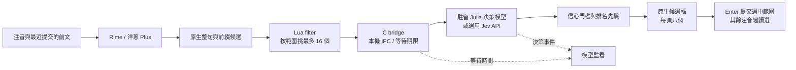

# 本地語意注音


讓中文輸入法讀懂前文，再決定候選怎麼排。本專案使用 Rime／小狼毫產生候選，以本機 Julia 決策模型比較整句與前綴詞組，保留原生詞庫、選字與學習流程。

預設是洋蔥注音 Plus 的精簡設定：臺灣繁體中文、英文與 emoji。安裝完成便使用 Julia，並設定 Windows 登入自動啟動。只有使用者在設定視窗切換後端，才會改用其他模型。

## 安裝

目前支援 Windows x64。下載本儲存庫 ZIP 並解壓縮到要長期保留的資料夾，執行 `install.cmd`。安裝後不要搬移或刪除該資料夾，輸入法註冊與自動啟動會使用這個位置。

安裝腳本會補齊 PowerShell 7、Git、uv、7-Zip 與 Python 依賴，下載固定版本的 Julia、Weasel／librime 和洋蔥詞庫，編譯本機 bridge，再註冊輸入法。Windows 的 UAC 提示需允許；安裝完成後按 **Win＋Space** 選擇「小狼毫」。Julia 不需要 API 金鑰。

若已裝好 PowerShell 7，也可從專案目錄執行：

```powershell
pwsh -ExecutionPolicy Bypass -File scripts/install.ps1
```

第一次下載模型需要網路。使用 Julia 時，日常推論只走本機；切換至官方 Jev 後，會將前文、注音與候選送到其 API。

安裝沿用倉庫內的候選窗、Shift 切換、emoji、AI 門檻與提示詞。後端選擇和提示詞保存在 `%LOCALAPPDATA%\LocalImeReranker`，重新安裝會保留已保存的選擇；個人詞庫留在 `runtime/windows/user`。

已有另一份小狼毫時，腳本會停止並顯示其路徑，避免接管另一份個人資料。請先處理既有安裝，再註冊這份版本。

## 使用

| 操作 | 效果 |
| --- | --- |
| 單按 Shift | 切換中英文；組字中會提交目前轉換文字 |
| Shift＋數字 | 選取對應候選 |
| Enter | 提交目前候選涵蓋的片段，剩下注音繼續選；完整候選則整句上屏 |
| Ctrl＋Alt＋A | 切換 AI，顯示短暫「AI 開／關」提示 |
| Ctrl＋Alt＋S | 開啟 AI 設定 |
| 中文模式下輸入 `3hello` | 呼叫 Plus 英文候選，可選出 `hello`，不必先切英文模式 |

Plus 的英文掛接有 `3` 前綴，不會把任意英文字母自動辨識成英文。日文、韓文、希臘文等掛接已停用，候選標籤使用純數字。emoji 保留上游的中文詞對應及反引號符號集入口。

AI 依這個輸入法工作階段最近提交的文字判斷，不讀取其他應用程式內容或剪貼簿。尚未提交前文、候選不足或注音尚未完成時，可以不呼叫模型。比較效果時，先提交一小段前文，再輸入容易有同音歧義的詞句。

## 整句與分段候選

Rime 輸入長句時，第一候選常是一整句。例如「然後我發現」後面仍有「然後我」、「然後」、「然」等原生前綴候選。這些候選涵蓋不同注音範圍，單純只比較整句候選會讓模型失去選擇空間。

目前 filter 最多讀取 48 個原生候選，按涵蓋範圍分組，輪流取各組候選，讓模型最多比較 16 個選項。畫面仍每頁顯示八個；模型判斷可靠時，把它選中的原生物件提到前面。整句與片段的 Rime quality 不在相同尺度上，因此跨範圍比較保留信心門檻與小幅排名先驗，不直接比較原始 quality。

提示詞要求：整句符合前文時保留整句；整句明顯不合理時，選語意確定且長度適當的前綴，不要一律退成單字。按 Enter 後，片段透過 Rime 原生確認與提交流程上屏，剩下注音重新產生候選。

這裡比較的是 **Rime 已產生的前綴候選**，不是所有可能的分詞組合，也不會生成詞庫外的新候選。缺少正確詞、同音資訊不足或上下文不夠時，模型仍可能選錯；Ctrl＋Alt＋A 可以直接比較原排序。

## AI 設定與監看

Julia 原生選擇題每題接受 2–20 個選項。本版採最多 16 個，候選池會涵蓋不同前綴長度，而不是為了塞滿數量只增加同一個字的罕見同音候選。

設定視窗可選 Julia（本地 CPU）或 Jev（官方 API），編輯共用提示詞，並輸入遮蔽顯示的 Jev 金鑰。按「儲存並套用」會重啟模型後端，Rime 繼續使用。金鑰保存在目前使用者的 Windows 環境設定，不寫入專案或紀錄。

從設定視窗按「模型監看」，或從開始選單開啟「小狼毫 AI 模型監看」，可查看：

- 實際後端、服務 PID 與就緒／推論狀態。
- 模型推論及輸入法實際等待的 P50、P95；採最近 256 筆，模型統計排除快取。
- 最近 100 筆判斷、快取、忙碌、錯誤、逾時／斷線事件，以及完整／片段選擇。
- 可另存的 JSON 紀錄與服務錯誤 log。

監看每秒讀取狀態，不主動要求推論。事件不含輸入文字、提示詞或金鑰。模型完成得較晚時，輸入法可能已達等待期限並使用原排序；「已回傳」也不等於 AI 改了排序，需同時看模型的採用結果。

## 系統架構



Julia 使用固定權重與匹配的官方 runtime，透過單一暖機推論執行緒執行，不讓每次候選更新重新載入模型。目前預設使用 CPU。等待預算為 150 ms；沒有把握、服務未就緒、忙碌、錯誤或超時時顯示 Rime 原排序。

## 開發與維護

| 位置 | 責任 |
| --- | --- |
| `rime/lua/local_ai.lua` | 候選範圍分組、模型 IPC 與原生物件重排 |
| `rime/lua/partial_commit.lua` | Enter 分段提交與保留剩餘組字 |
| `native/ai_bridge.c` | 等待期限、本機 TCP 與非阻塞等待時間回報 |
| `src/ime_reranker/decision_input.py` | 前文、Rime 原句、候選範圍與共用提示詞 |
| `src/ime_reranker/policy.py` | 信心門檻及完整／分段候選的排名規則 |
| `src/ime_reranker/server.py` | 模型生命週期、快取與狀態端點 |
| `src/ime_reranker/telemetry.py` | 有上限的事件及延遲樣本 |
| `scripts/stage_onion_plus.py` | 固定版洋蔥 Plus 與中英／emoji 精簡設定 |
| `scripts/ai-settings.ps1`、`scripts/ai-monitor.ps1` | 原生設定與監看視窗 |
| `config/` | 初始提示詞、模型設定、方案與來源版本 |

```powershell
pwsh -File scripts/start-windows.ps1     # 依使用者保存的後端啟動
pwsh -File scripts/stop-windows.ps1      # 停止本專案服務
pwsh -File scripts/uninstall-windows.ps1
```

必要的候選／提交行為檢查：

```powershell
.venv\Scripts\python.exe scripts/check_candidate_pool.py
.venv\Scripts\python.exe scripts/check_partial_commit.py
```

分段提交已確認會保留剩下注音，完整候選會整句上屏。候選池檢查使用三段不同長度的注音，確認其原生前綴範圍都有進入模型選項。這些是工程行為檢查，不能當作日常準確率或新版效能 benchmark；全新電腦的完整安裝流程尚未實測。

## 來源與授權

概念參考 [Jevboard](https://github.com/AsheeHuang/Jevboard)。輸入法基於 [Rime／Weasel](https://github.com/rime/weasel) 與[洋蔥方案](https://github.com/oniondelta/Onion_Rime_Files)，本地模型使用 [Julia 1](https://huggingface.co/SupersonicLabs/Julia-1)。模型、執行檔及詞庫由安裝腳本從上游下載，不隨此儲存庫散布。

自行撰寫程式碼採 [MIT License](LICENSE)。**洋蔥方案有非商業使用限制**，整套安裝內容不能僅以 MIT 授權概括。第三方來源、授權與固定版本見 [THIRD_PARTY.md](THIRD_PARTY.md)、`assets.lock.json` 及 `config/onion-plus.lock.json`。
